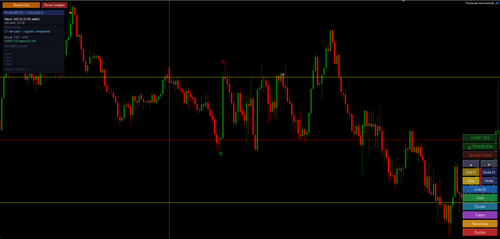

# Expert Advisor — Funcionario Automatizado

> Robô algorítmico proprietário desenvolvido em MQL5 para execução automatizada de ordens no par **XAUUSD (Ouro)** via MetaTrader 5. Opera com lógica de rompimento de canais projetados, gestão de risco quantitativa e motor de decisão multi-variável.

> ⚠️ **O código-fonte é proprietário e não está disponível publicamente.** Este repositório apresenta a arquitetura, capacidades do sistema e resultados de backtest.

---

## Visão Geral

O **Funcionario Automatizado** é um Expert Advisor (EA) desenvolvido integralmente por **Paulo H. — PHrobots LTDA**, com foco em operações algorítmicas no mercado financeiro. O sistema opera em modo **totalmente automático** ou **semi-manual**, com canal de rompimento definido automaticamente ou desenhado manualmente pelo operador.

---

## Arquitetura do Sistema

```
DETECÇÃO DE CANAL (CR)
├── Modo Automático → Leitura e projeção de canal via candles
└── Modo Manual     → Linhas desenhadas pelo operador no gráfico

MOTOR DE DECISÃO
├── CHOP Index      → Filtro de mercado lateralizado
├── ADX             → Filtro de força de tendência
├── Break-Even      → Proteção automática de lucro
├── Pullback Filter → Controle de zona de entrada
└── CHOP Pending    → Memória de rompimento bloqueado

GESTÃO DE RISCO
├── Risco fixo em dólares por trade
├── Risco percentual do saldo (configurável)
└── Dimensionamento automático de lote

MODO BOOSTER (Multi-Ciclo)
├── Modo Normal   → Controle por takes/stops absolutos
├── Modo Positivo → Controle por saldo líquido
├── Virada de Mão → Entrada oposta após stop
└── Filtro de Tendência integrado

PROTEÇÃO E RESILIÊNCIA
├── Mutex multi-instância (sem ordens simultâneas)
├── Persistência de estado diário (arquivo .dat)
├── Magic Number único por símbolo
└── Expiração por data hardcoded
```

---

## Motor de Decisão — Variáveis

| Variável | Função |
|---|---|
| **CHOP Index** | Detecta mercado lateralizado e bloqueia entradas sem tendência |
| **ADX** | Mede força da tendência antes de autorizar entrada |
| **CHOP Pending** | Memoriza rompimentos durante CHOP alto e age quando mercado melhora |
| **Filtro Combinado** | ADX + CHOP simultaneamente para máxima precisão |
| **Exigir Direção Oposta** | Segunda entrada obrigatoriamente contrária à primeira |

---

## Gestão de Trade

| Parâmetro | Descrição |
|---|---|
| **Take Profit** | Calculado em múltiplos do tamanho do canal (CR) |
| **Stop Loss** | Calculado como fração configurável do canal |
| **Break-Even** | Ativado após N níveis de lucro — modo Fechamento ou Toque |
| **Pullback Zone** | Zona de entrada com cancelamento automático |
| **Limite Diário** | Número máximo de operações por dia |

---

## Modo Booster

| Sub-Modo | Comportamento |
|---|---|
| **Normal** | Para após X takes ou Y stops absolutos no dia |
| **Positivo** | Para quando saldo líquido de takes − stops atinge o threshold |
| **Virada de Mão (Sem Reset)** | Após stop, entra na direção oposta no mesmo canal |
| **Virada de Mão (Com Reset)** | Após stop, aguarda novo canal bloqueando direção do stop anterior |

---

## Proteções do Sistema

| Sistema | Descrição |
|---|---|
| **Mutex Inter-Instâncias** | Múltiplos robôs no mesmo terminal sem ordens simultâneas |
| **Persistência de Estado** | Estado diário salvo em arquivo — resiste a reinicializações |
| **Horário de Bloqueio** | Intervalos configuráveis sem abertura de ordens |
| **Encerramento por Horário** | Posições fechadas automaticamente no horário limite |
| **Filtro de Calendário** | Bloqueio nos últimos pregões úteis do mês |
| **Dias de Operação** | Controle individual por dia da semana |
| **Notificações Push** | Alertas via MetaTrader para C1, Pullback e Cancelamentos |

---

## Stack Tecnológica


- **Linguagem:** MQL5 (compilado nativo para MT5)
- **Plataforma:** MetaTrader 5
- **Ativo principal:** XAU/USD (Ouro)
- **Multi-símbolo:** Suporte a múltiplas instâncias com magic number único por ativo

---

## Resultados de Backtest

Arquivos disponíveis na raiz do repositório:
- `chart_xauusd.png` — Print do robô em operação no gráfico
- `backtest_results.xlsx` — Relatório detalhado de operações



---

## Direitos Autorais

© 2026 Paulo H. — PHrobots LTDA. Todos os direitos reservados.
Este software é proprietário. Qualquer reprodução ou uso não autorizado é expressamente proibido.

---

## Autor

**Paulo Henrique Matos de Souza**
🔗 [phrobots.com.br](https://phrobots.com.br) · 📧 paulohenriquems1975@gmail.com
