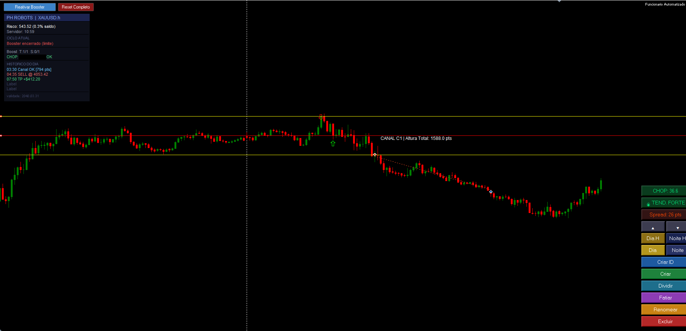

# Expert Advisor — Funcionario Automatizado


> Robô algorítmico proprietário desenvolvido em MQL5 para execução automatizada de ordens no par **XAUUSD (Ouro)** via MetaTrader 5. Opera com lógica de rompimento de canais projetados, gestão de risco quantitativa e motor de decisão multi-variável.


> ⚠️ **O código-fonte é proprietário e não está disponível publicamente.** Este repositório apresenta a arquitetura, capacidades do sistema e resultados de backtest.


---


## 📸 Capturas de Tela

> Robô em operação real — par XAUUSD (Ouro) no MetaTrader 5




## Visão Geral


O **Funcionario Automatizado** é um Expert Advisor (EA) desenvolvido integralmente por **Paulo H. — PHrobots LTDA**, com foco em operações algorítmicas no mercado financeiro. O sistema opera em modo **totalmente automático** ou **semi-manual**, com canal de rompimento definido automaticamente ou desenhado manualmente pelo operador.


---


## Arquitetura do Sistema


```
DETECÇÃO DE CANAL (CR)
├── Modo Automático → Leitura e projeção de canal via candles
└── Modo Manual     → Linhas desenhadas pelo operador no gráfico


MOTOR DE DECISÃO
├── CHOP Index      → Filtro de mercado lateralizado
├── ADX             → Filtro de força de tendência
├── Break-Even      → Proteção automática de lucro
├── Pullback Filter → Controle de zona de entrada
└── CHOP Pending    → Memória de rompimento bloqueado


GESTÃO DE RISCO
├── Risco fixo em dólares por trade
├── Risco percentual do saldo (configurável)
└── Dimensionamento automático de lote


MODO BOOSTER (Multi-Ciclo)
├── Modo Normal   → Controle por takes/stops absolutos
├── Modo Positivo → Controle por saldo líquido
├── Virada de Mão → Entrada oposta após stop
└── Filtro de Tendência integrado


PROTEÇÃO E RESILIÊNCIA
├── Mutex multi-instância (sem ordens simultâneas)
├── Persistência de estado diário (arquivo .dat)
├── Magic Number único por símbolo
└── Expiração por data hardcoded
```


---


## Motor de Decisão — Variáveis


| Variável | Função |
|---|---|
| **CHOP Index** | Detecta mercado lateralizado e bloqueia entradas sem tendência |
| **ADX** | Mede força da tendência antes de autorizar entrada |
| **CHOP Pending** | Memoriza rompimentos durante CHOP alto e age quando mercado melhora |
| **Filtro Combinado** | ADX + CHOP simultaneamente para máxima precisão |
| **Exigir Direção Oposta** | Segunda entrada obrigatoriamente contrária à primeira |
